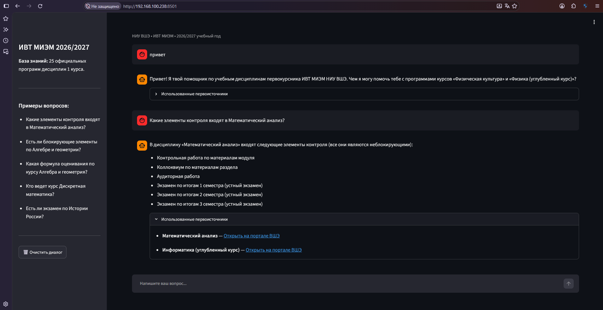

Интеллектуальный веб-ассистент на базе RAG (Retrieval-Augmented Generation) по учебным дисциплинам 1 курса образовательной программы «Информатика и вычислительная техника» МИЭМ НИУ ВШЭ за 2026/2027 учебный год.

> **Отборочный проект для мастерской VK и МИЭМ НИУ ВШЭ.**

---

## Возможности решения
-  **Поиск по 25 дисциплинам:** автоматический сбор и обработка всех официальных программ дисциплин (ПУД) 1 курса с портала ВШЭ.
-  **Формулы и элементы контроля:** точный расчет формул аттестации по модулям, весов экзаменов, выявление блокирующих и неблокирующих элементов.
-  **Первоисточники:** цитирование с кликабельными ссылками на официальный сайт ВШЭ.
-  **Защита от галлюцинаций:** строгие инструкции — модель не придумывает информацию, если её нет в программе.
-  **Веб-интерфейс:** современный интерактивный чат на Streamlit с историей диалога и примерами вопросов.
-  
---

## Архитектура и стек технологий
- **Язык программирования:** Python 3.10+
- **RAG-фреймворк:** LlamaIndex
- **Поисковый движок:** BM25 Retriever (локальный быстрый поиск по терминам без задержек и лимитов API)
- **Языковая модель (LLM):** Google Gemini Flash Lite (высокая скорость генерации, качественный русский язык)
- **Сбор данных:** Requests + BeautifulSoup4
- **Веб-интерфейс:** Streamlit

---

## Инструкция по локальному запуску


```bash
git clone https://github.com/ваш_логин/hse-ivt-rag-assistant.git
cd hse-ivt-rag-assistant

# 2. Создание и активация виртуального окружения
python3 -m venv venv
source venv/bin/activate  # Для Linux / WSL
# .\venv\Scripts\activate # Для Windows

# 3. Установка зависимостей
pip install -r requirements.txt

# 4. Настройка API-ключа
# Создайте файл .env и добавьте туда ваш ключ:
# GEMINI_API_KEY=ваш_ключ_из_google_ai_studio

# 5. Запуск веб-интерфейса
streamlit run app.py
```